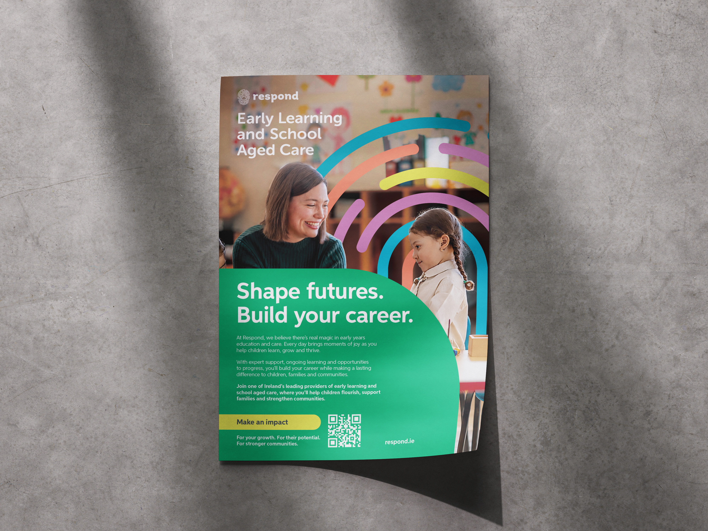
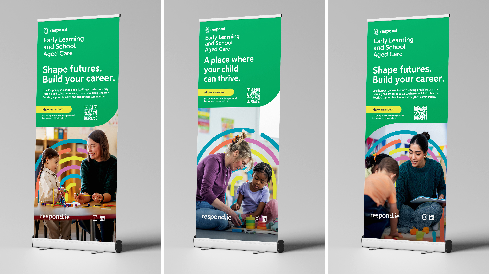
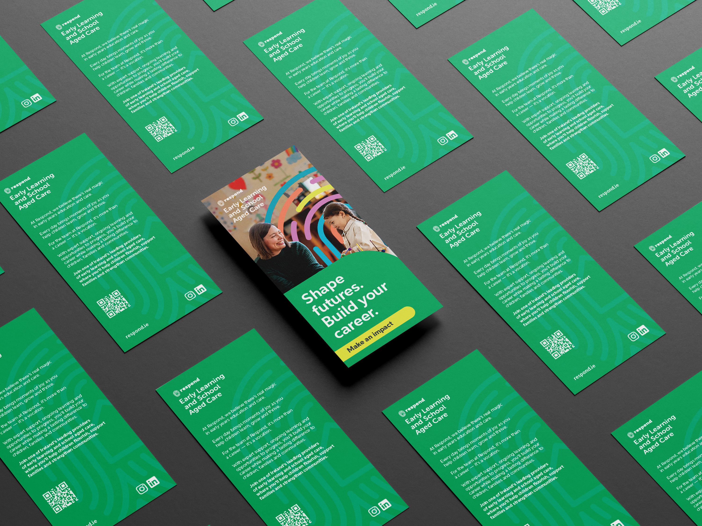
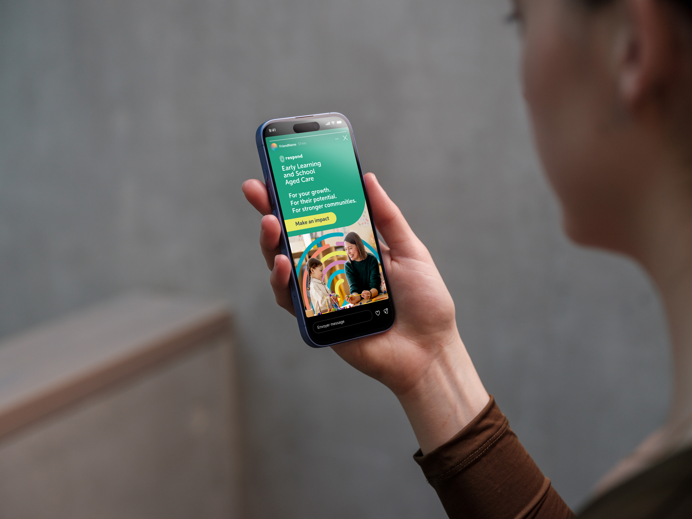
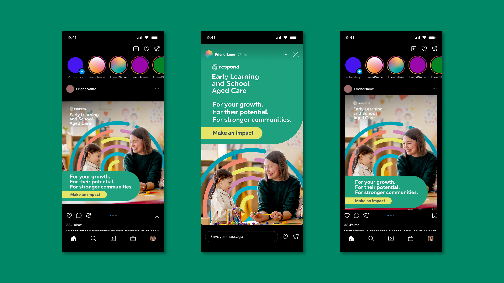

Respond is one of Ireland’s largest not-for-profit housing associations, providing social and affordable homes and support services to families and individuals. Its brand has to earn the trust of tenants, local authorities, and the wider community.

At Originate, I designed a suite of recruitment creatives to communicate Respond’s workforce benefits and attract certified practitioners to its nationwide Early Learning & School-Aged Care services in the ELSAC recruitment campaign.

Spanning roll-up banners (tailored for recruitment and parent outreach), A4 poster, DL leaflet, and social media graphics. Responsible for the overall visual hierarchy, image compositing, and layout execution. I used tools such as Adobe InDesign, Photoshop (Firefly, Nano banana), Illustrator to succeed in my exciting challenge to maintain strict brand adherence while effectively communicating across print and digital formats to engage early childhood educators, local families, and community members.

The campaign is scheduled for a future rollout, so success was measured through direct client satisfaction and deliverables. I delivered all print and digital assets on time, earning strong client appreciation for introducing a modern, trend-forward aesthetic that stood out while strictly adhering to Respond’s brand guidelines.

By strategically integrating a QR code with the URL, I solved the issue of text-heavy banners, ensuring a seamless user experience for scanning and accessibility. During this project, I learned the value of capitalizing on relatable, human-centric imagery to convey core messages of opportunity and community, and how thoughtful UX adjustments, like QR codes, can bridge physical print assets with digital landing pages effectively.

