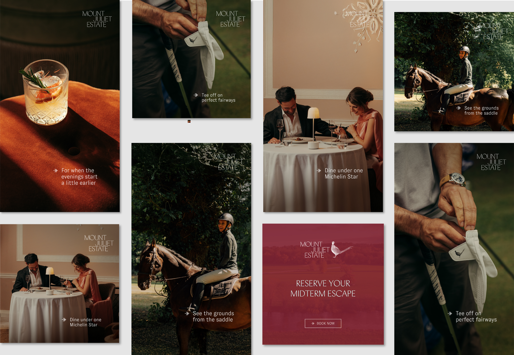
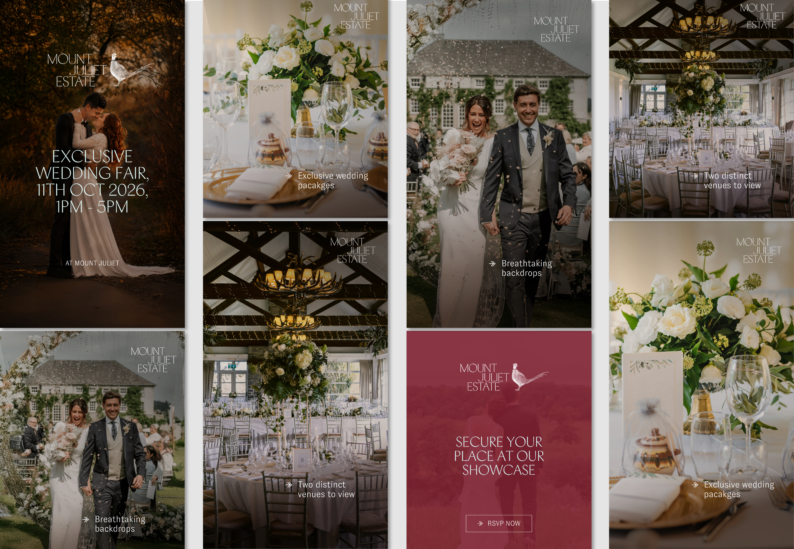
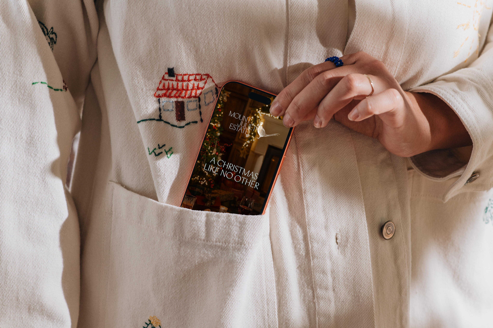
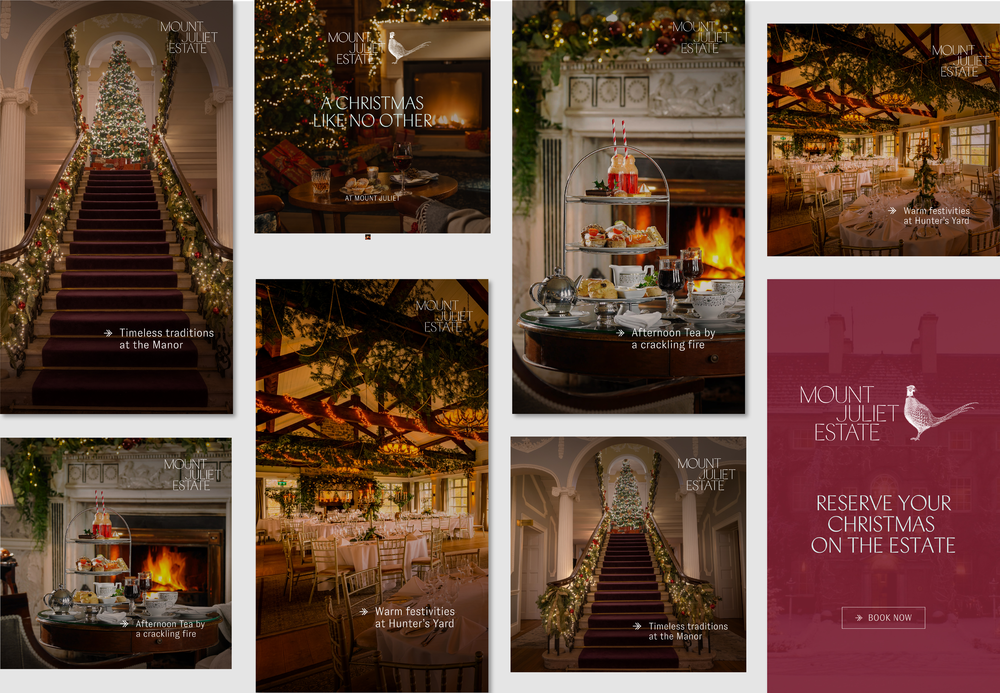

Ireland’s premier 5-star luxury heritage resort, set across a magnificent 500-acre parkland in County Kilkenny. Home to a historic Georgian Manor House, contemporary country stays at Hunter’s Yard, a Jack Nicklaus Signature Golf Course, and the Michelin-starred Lady Helen restaurant, the estate is part of Marriott’s exclusive Autograph Collection.

I designed a targeted Meta advertising campaign focused on seasonal and thematic promotions to drive audience engagement and bookings. Its visual and brand communications required an elevated, timeless, and sophisticated aesthetic that reflects world-class hospitality and heritage.

I developed 10 to 15 seasonal Meta advertising campaigns for Mount Juliet Estate, adapting creative assets across multiple social aspect ratios (9:16, 4:5, and 1:1). Operating under a 1 week deadline, I took full accountability for all visual creative while adhering to strict brand rules around logo placement, color palettes, and safe-zone guidelines. 

The primary challenge was tailoring the visual messaging to potential diverse audiences a few including golf enthusiasts, wedding events, and corporate retreat executives, to drive engagement and maximise return on ad spend across Meta’s targeted segments.

I established a consistent structural pattern, centred primary text with the logo positioned at the top, integrating subtle gradients to ensure high copy legibility over varied photography, and capping each slide with a distinct color-blocked Call-to-Action (CTA) panel.

Working in Adobe Photoshop, I retouched and optimised campaign photography. Where aspect ratios demanded it, I utilised generative AI (Adobe Firefly) to expand backgrounds, complementing this with manual cleanup using cloning, smoothing, and blending tools to preserve visual quality.

Every carousel or multi-slide campaign was designed to evoke emotion and narrative depth by alternating between striking hero imagery and detail shots. I carefully adjusted contrast, color balance, and gradient overlays to unify the series.

By establishing a robust template system and maintaining a tight feedback loop with the client and social team, I successfully scaled, refined, and delivered all 10 to 15 campaign creative assets within a one-week turnaround.

The campaign creative yielded immediate qualitative success, significantly boosting user engagement and driving qualified click-throughs to Mount Juliet Estate's booking channels. 

Beyond mastering AI-assisted image expansion and templating in Illustrator and Photoshop, this project highlighted the crucial role of precise asset versioning and naming structures when executing high-volume digital collateral against fast turnarounds.
