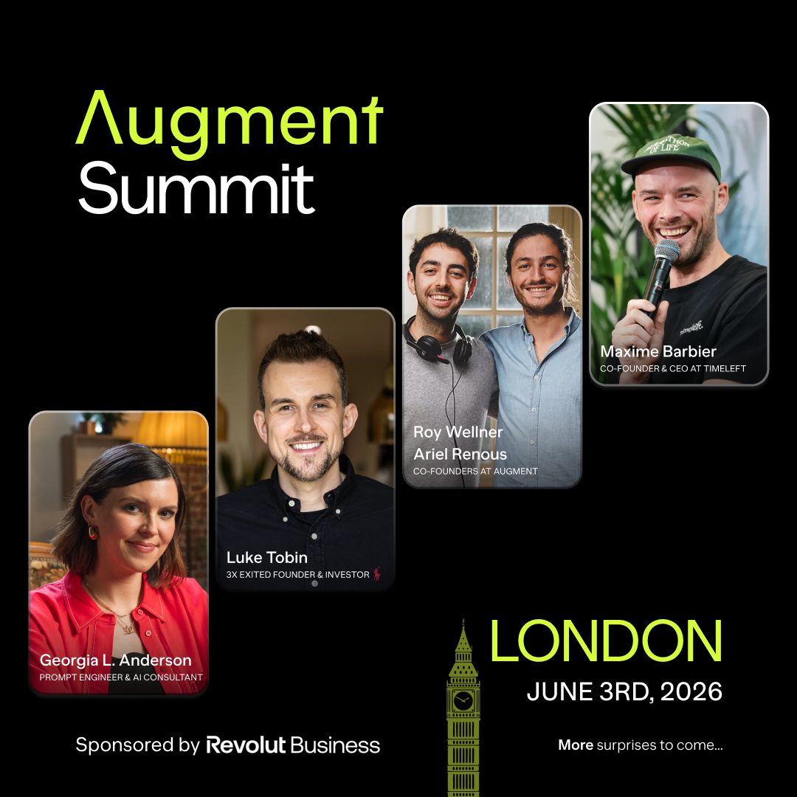
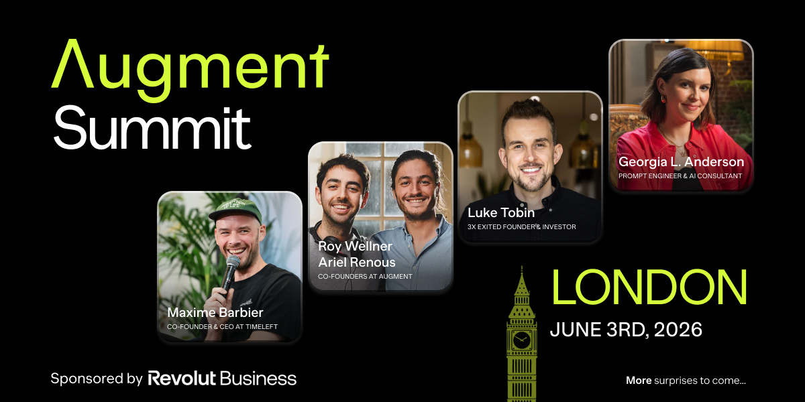
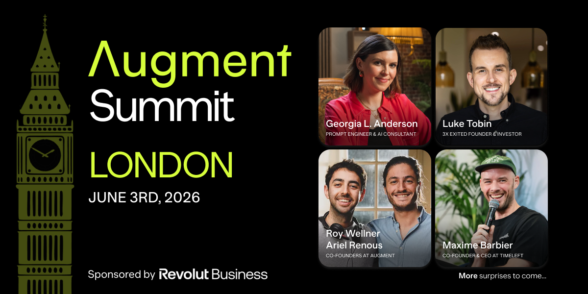
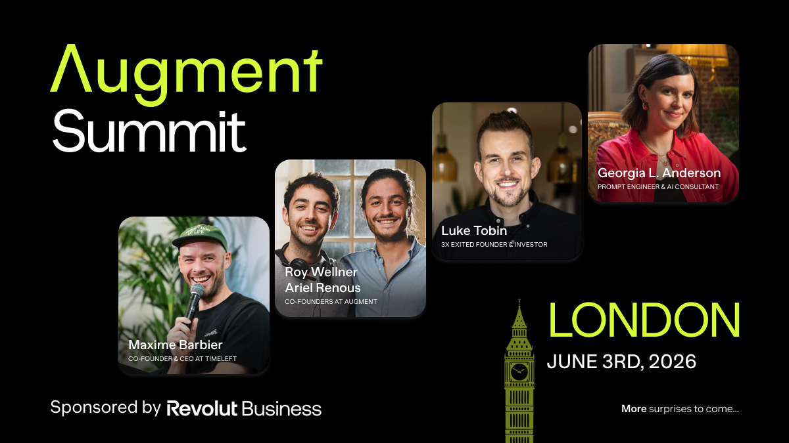
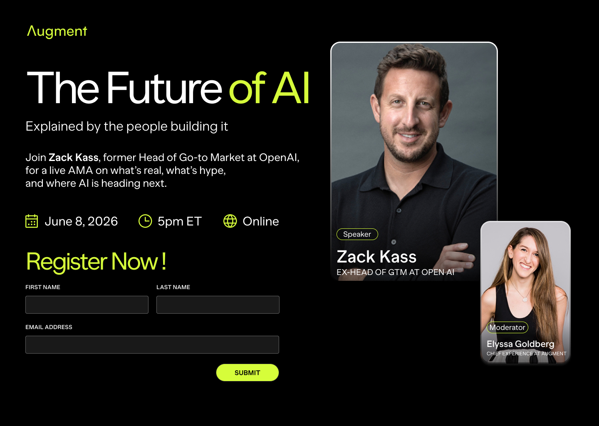

## Brief 1

This is my take on redesigning brief 1 to a more dynamic version that shows a visual representation of a summit of the speakers in an upward diagonal position and resizing the cards to give equal emphasise.

I integrated the Augment logo for brand awareness, placed the texts in a Z pattern so that it drives the eye to key information top to bottom rather than all at once.

I also leveraged the Big Ben icon to be placed next to the location and date information for relatability.

## Brief 2

For brief 2, I gave emphasis to the main speaker and also using dual colors to shift focus towards the title, adding bold types as well as icons to highlight the details of the session.

I have shortened the text to keep the required information, reduce cognitive overload, making it easy & frictionless to consume information.

I have also provided an option with all of the copy given and it requires iterations/clarification on what needs to be emphasized according to user data or marketing reports.

