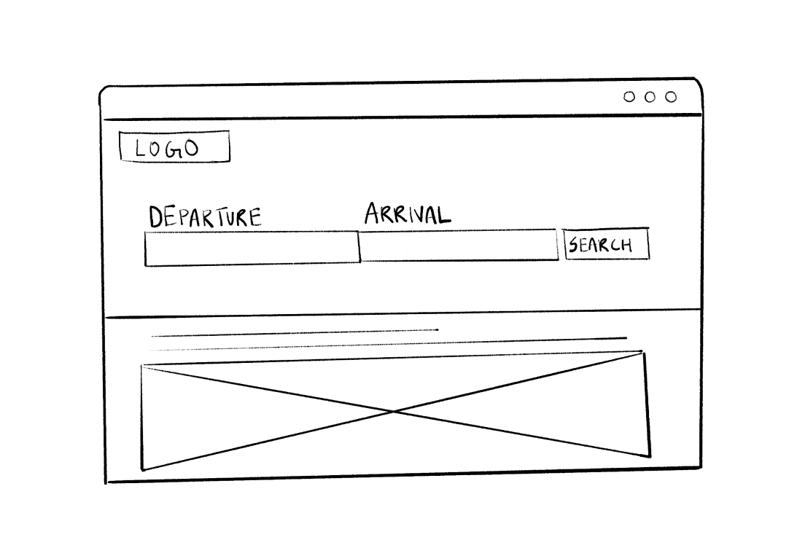
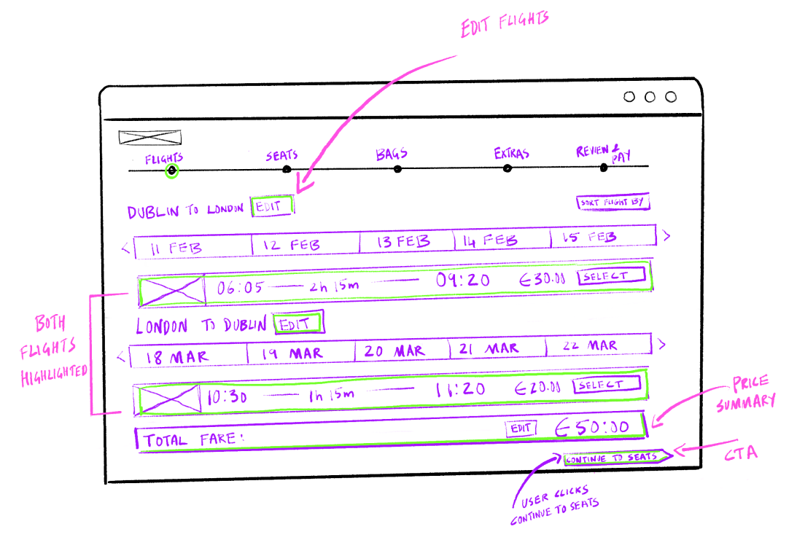
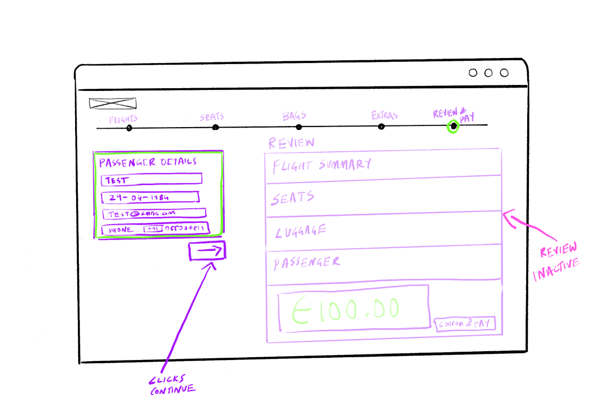
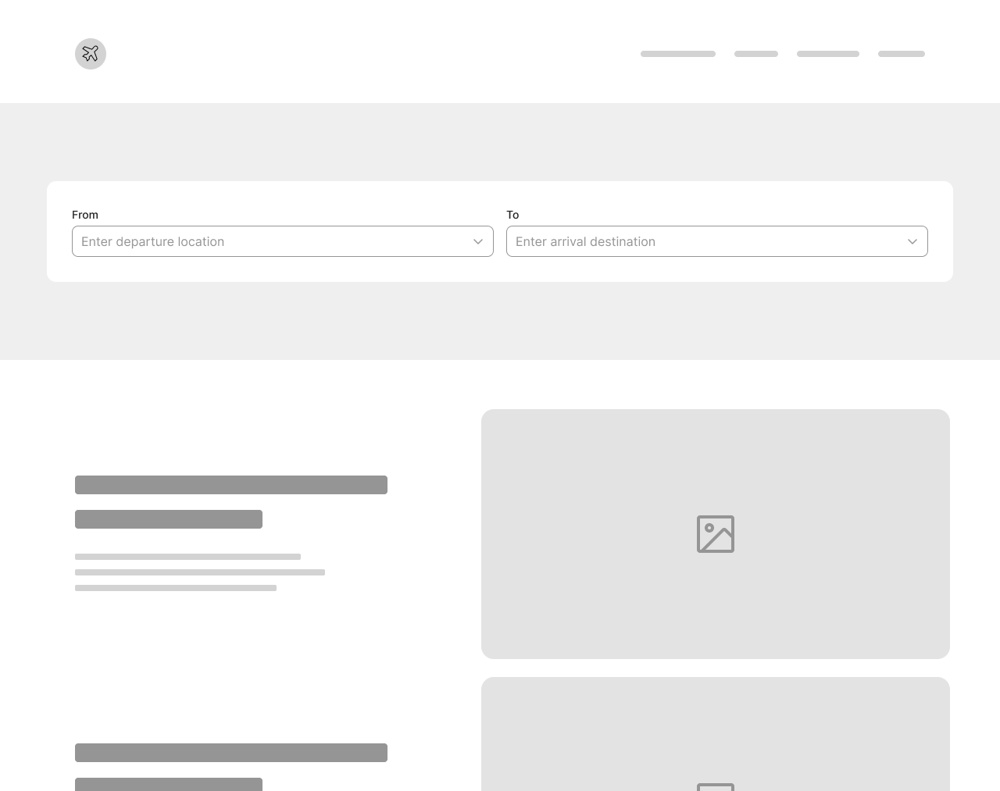
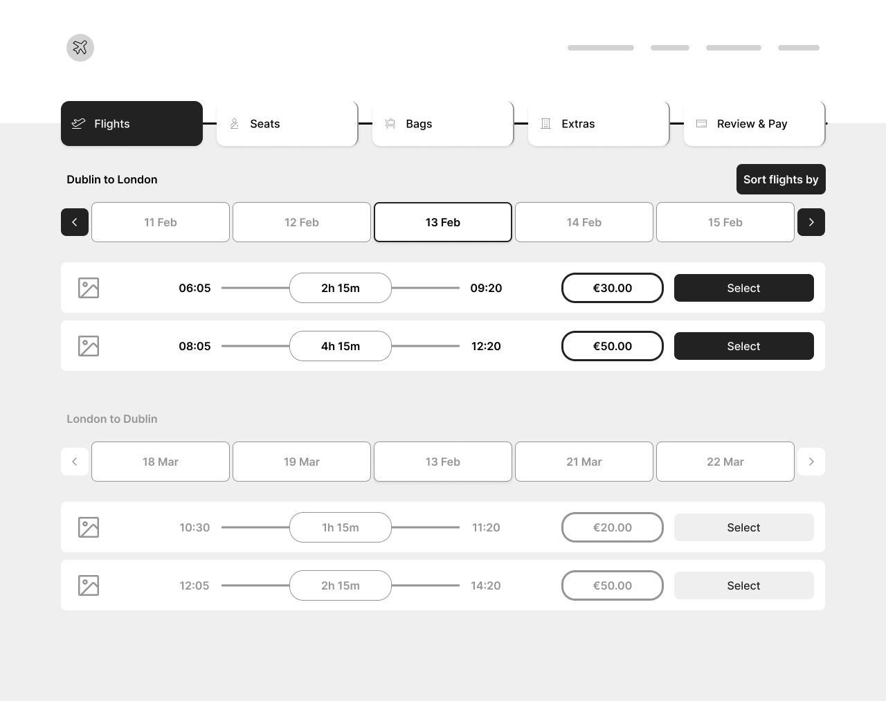
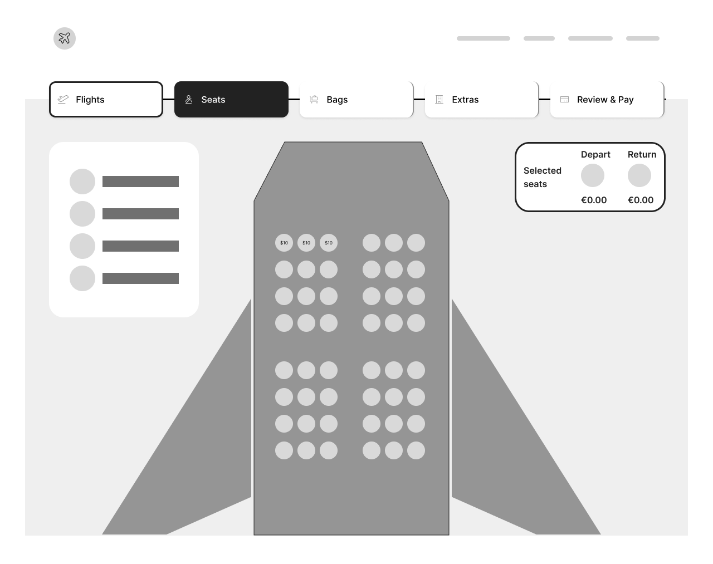
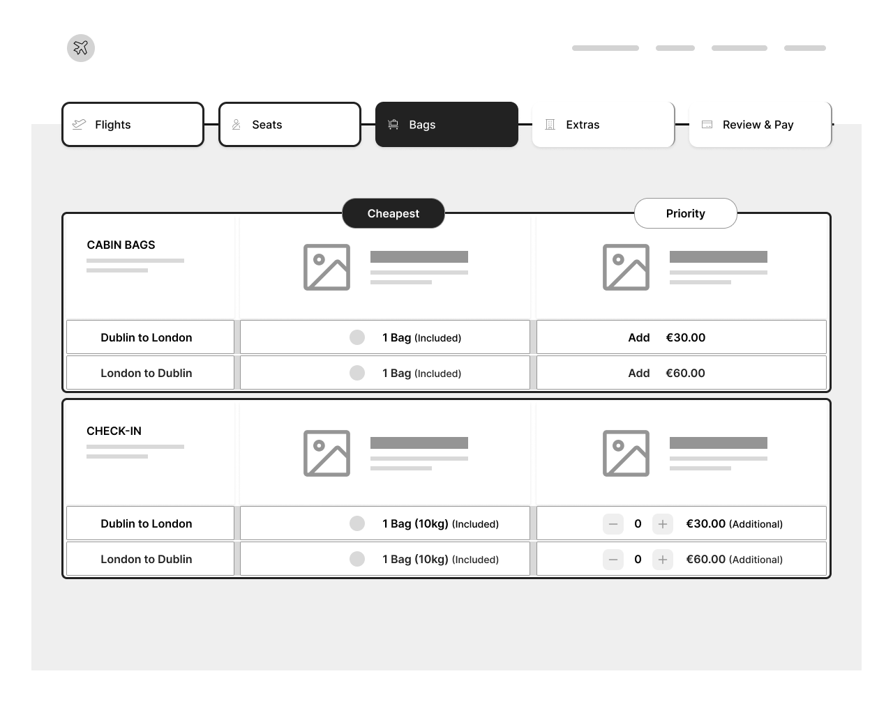
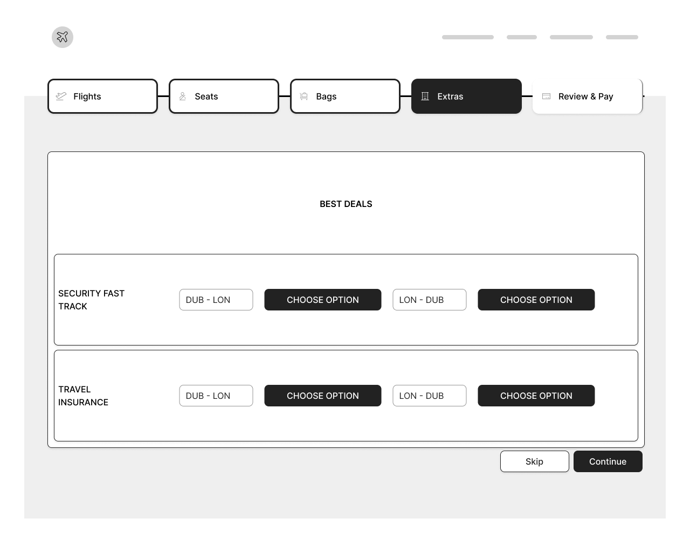
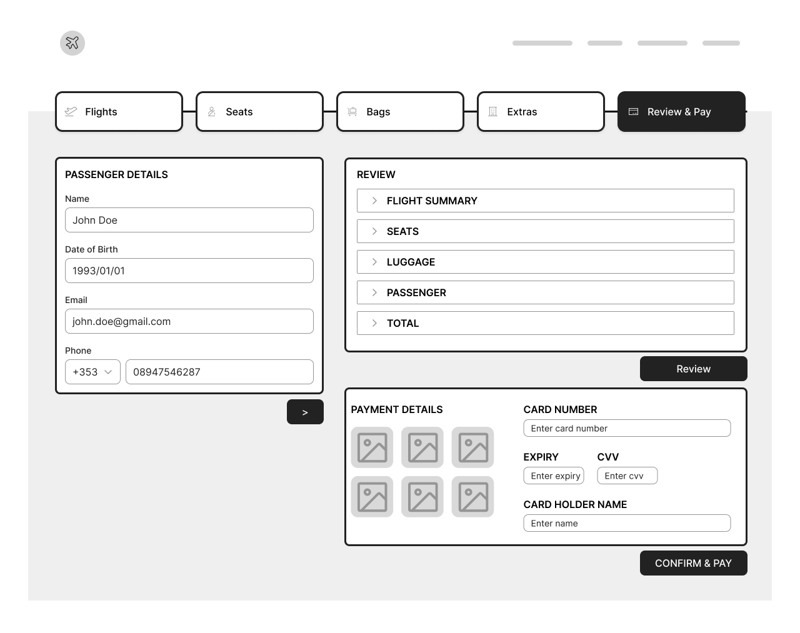
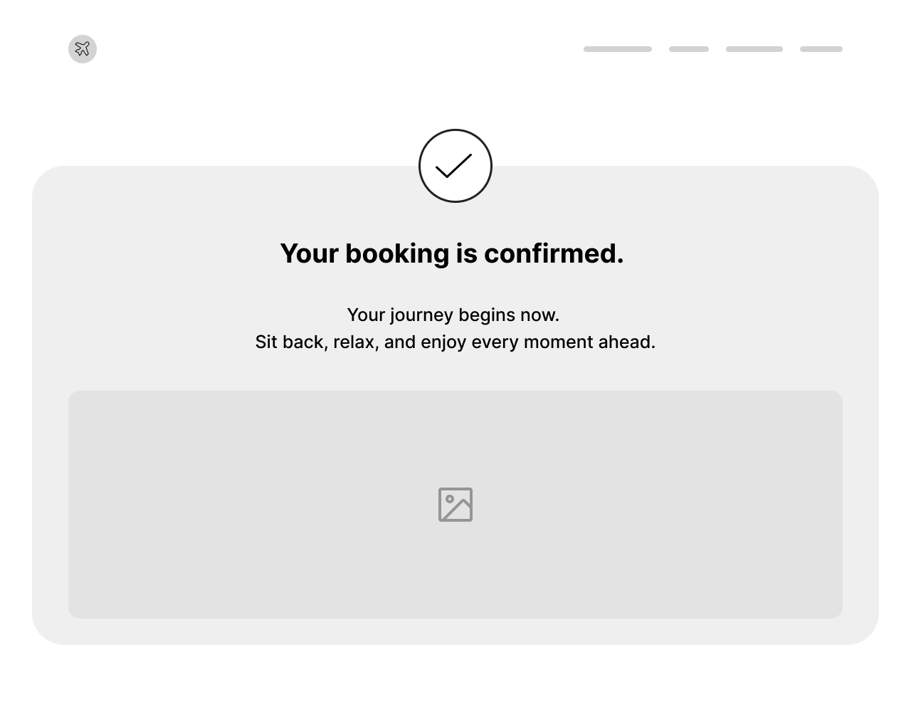

The prototype below is a styled, working rebuild of the wireframed flow: search, flights, seats, bags, extras, then passenger details and payment on one screen. Use the stepper to jump back and change a choice; nothing you picked is lost. It is a personal build made after the usability sessions, which ran on the Figma wireframe prototype. All fares and flights are illustrative.

